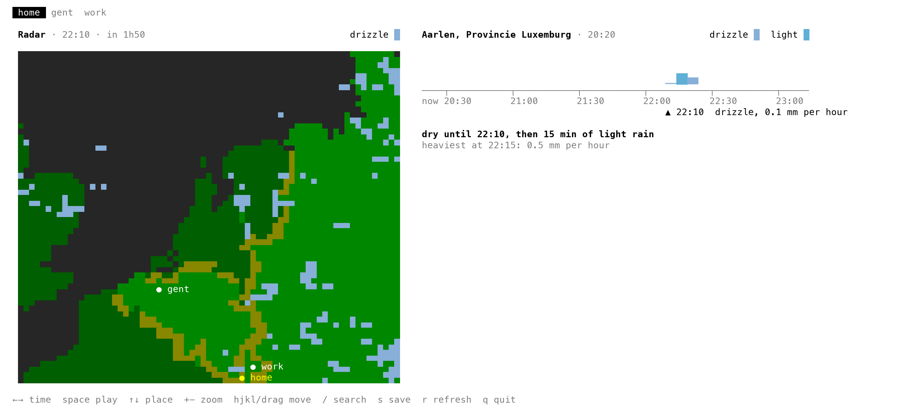
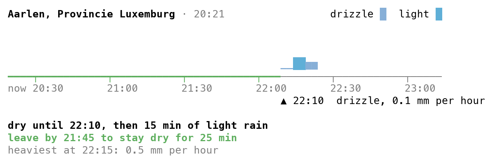
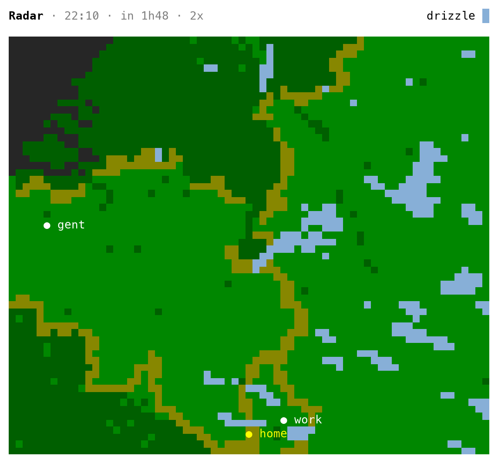

# raincheck

Should I cycle now? `raincheck` fills your terminal with Buienradar's rain radar, playing the next two hours over a map of the Low Countries with your places on it. Beside the map, or below it on a narrow terminal, is a chart of the rain at your place for the next three hours, with a summary such as "dry until 14:20, then 15 min of light rain". It works in the Netherlands, Belgium and the border regions.

<picture>
  <source media="(prefers-color-scheme: dark)" srcset="docs/screenshots/live-dark.png">
  
</picture>

## Install

With [uv](https://docs.astral.sh/uv/) or [pipx](https://pipx.pypa.io/):

```sh
uv tool install git+https://github.com/PieterLuypaert/raincheck
pipx install git+https://github.com/PieterLuypaert/raincheck
```

Update with `uv tool upgrade raincheck` or `pipx upgrade raincheck`.

Or as one file, since raincheck needs nothing but `python3` (3.9 or newer):

```sh
mkdir -p ~/.local/bin
curl -fsSL https://raw.githubusercontent.com/PieterLuypaert/raincheck/main/raincheck -o ~/.local/bin/raincheck
chmod +x ~/.local/bin/raincheck
```

Run `raincheck`, or `raincheck -h` for every option. The first time, raincheck asks where home is.

raincheck used to be called buien. Installed it under that name? Install it again as raincheck: the first time it runs, it moves your saved places over.

## When to leave

`raincheck --trip 25` tells you when to leave to stay dry on a 25-minute ride, such as "leave between 15:20 and 15:30 to stay dry for 25 min", and draws that dry stretch in green on the chart's time axis. With `--short` it exits with 0 when you can leave right now and with 2 when you cannot, so a script can decide for you:

```sh
raincheck --trip 20 --short >/dev/null && echo "go now" || echo "wait a bit"
```

<picture>
  <source media="(prefers-color-scheme: dark)" srcset="docs/screenshots/trip-dark.png">
  
</picture>

## The live screen

Plain `raincheck`, or `raincheck gent` for somewhere else, opens the live screen with a tab for every saved place. The map plays the radar's next two hours, and the cursor in the chart moves along with it. On a wide terminal the map sits beside the chart, otherwise above it. Everything refreshes by itself: the forecast every minute, the radar every five.

| Key | Does |
| --- | --- |
| ← → or the scroll wheel | pause and move through the hours; the map shows that moment, and the line under the chart gives the rain then |
| space | play the map again |
| ↑ ↓ or tab | the previous or next place |
| + and - | zoom the map in and out around the place on screen, up to four times |
| h j k l, or drag with the mouse | move the zoomed map; c brings it back to the place |
| / | search a place, which opens in a tab of its own |
| s | save the place on screen under a name |
| r | fetch the forecast and the radar again, past the cache |
| q or esc | quit |

With `--trip 25` it also says when to leave, for whichever place is on screen. In a short terminal the map makes way for the chart. raincheck takes the scroll wheel, so to select text, hold the modifier your terminal uses for that, such as Option or Shift.

Zoomed in, raincheck asks Buienradar for the radar that much bigger, so the rain stays as sharp as Buienradar has it rather than growing into blocks. The map is Buienradar's own radar over a map of the area it covers. The radar of now lags the clock by about ten minutes, which the title says, and the frames after it are Buienradar's forecast. The kinds of rain on the map follow Buienradar's colours roughly; the chart has the exact amounts for your place.

<picture>
  <source media="(prefers-color-scheme: dark)" srcset="docs/screenshots/zoom-dark.png">
  
</picture>

`raincheck --once` prints the map of now and the chart once and gives you the prompt back. Piped into another command, raincheck prints the chart as plain text.

## Tab completion

raincheck completes its options and your saved places. Add the line for your shell to its startup file:

```sh
eval "$(raincheck --completions zsh)"     # ~/.zshrc, after compinit
eval "$(raincheck --completions bash)"    # ~/.bashrc
raincheck --completions fish > ~/.config/fish/completions/raincheck.fish
```

## In a status bar or a script

`raincheck --short` prints only the summary and `raincheck --json` the whole forecast. A forecast is reused for five minutes, so a status bar may run raincheck as often as it likes. In tmux, for example:

```tmux
set -g status-right '#(raincheck --short)'
```
